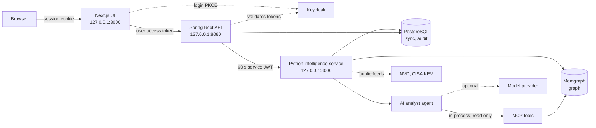

# ThreatLens AI

ThreatLens AI is a defensive security-intelligence platform. It ingests public vulnerability data (NVD, CISA KEV), links it to an organization's asset inventory in a graph (Memgraph), and lets an AI analyst investigate through MCP tools, for example "which of my assets are affected by this CVE?".

Full design: [docs/PROJECT_SPEC.md](docs/PROJECT_SPEC.md). Build plan: [docs/ROADMAP.md](docs/ROADMAP.md).

## Safety boundary

- Defensive and read-only. No exploitation, scanning of third-party systems, or remediation actions.
- Demo data is synthetic. No real organization data is used.
- Matches between vulnerabilities, products and assets are never guessed; unclear matches stay `unknown`.
- Tenant identity comes from trusted server context, never from model or tool input.
- External threat-feed content is treated as untrusted data.
- Secrets live in `.env` (git-ignored); only placeholders are committed.

## Architecture



The browser never holds a token and never talks to the Python service, the databases or the model. Spring Boot is the security boundary; the Python service trusts only its short-lived service token. Details: [web UI](docs/architecture/web-ui.md), [analyst agent](docs/architecture/analyst-agent.md), [graph model](docs/architecture/graph-model.md), [threat model](docs/threat-model/README.md), [decisions](docs/adr/).

## Implemented and planned

Scope baseline: spec section 20. This table says what exists today, not what is intended.

| Area | Status | Notes |
|---|---|---|
| NVD CVE sync and CISA KEV flags | Implemented | Manual and API-triggered; real data, recorded fixtures in tests |
| Synthetic assets, CSV/JSON inventory import with reject report | Implemented | Idempotent re-import |
| Product/version matching (confirmed, possible, not affected, unknown) | Implemented | Never guesses; ADR 0003 |
| Memgraph graph, tenant-scoped queries | Implemented | Provenance and timestamps kept |
| Spring Boot API, Keycloak login, roles, tenant from token | Implemented | Audit trail, rate limits |
| MCP servers: Vulnerability and Asset (8 read-only tools) | Implemented | Usable from Claude Code through `.mcp.json` |
| AI analyst with tool discovery, trace, evidence, grounding check | Implemented | Deterministic mock model by default; real-model adapter written, not yet run against a live key |
| Web UI: overview, sources, CVE page with graph, analyst | Implemented | Browser-tested against the real stack |
| Tests: unit, integration, tenant isolation, JWT tampering, malformed input, e2e | Implemented | See "Tests and CI" |
| JSON logs with correlation ids and secret redaction, admin metrics | Implemented | |
| MITRE ATT&CK, STIX/TAXII, URL import with SSRF protection | Planned | Needs its own threat review |
| Threat Actor, Attack Path, Incident and Risk MCP groups; multi-hop path analysis | Planned | Demo step 7 and 8 of spec section 18 (attack paths) are not available yet |
| Scheduler and queues, semantic tool search, load and ZAP tests | Planned | |
| Hosted deployment, SSO beyond local Keycloak, enterprise integrations | Planned | Local only today |

## Tests and CI

```bash
cd intelligence-service && uv run pytest                                      # unit and integration (needs docker compose --profile test up -d --wait memgraph-test)
cd intelligence-service && uv run pytest ../tests/security -c pyproject.toml --rootdir .   # tenant isolation, JWT tampering, malformed input
cd backend && ./mvnw test                                                    # API, security boundary, audit (Docker for Testcontainers)
cd frontend && pnpm test && pnpm typecheck && pnpm lint && pnpm build        # UI
cd frontend && pnpm e2e                                                      # browser tests against the running stack
```

GitHub Actions ([.github/workflows](.github/workflows)) runs all of the above except the browser tests on every pull request, the browser tests on `main`, CodeQL and secret scanning, and Dependabot proposes dependency updates. CI uses recorded fixtures and the mock model: it needs no real keys.

## Quick start

Prerequisite: Docker Desktop (WSL 2 backend, at least 8 GB RAM). On Windows, run the commands below from Git Bash or WSL.

```bash
cp .env.example .env              # first time only; edit passwords if you like
docker compose up -d --wait       # start Memgraph and PostgreSQL (localhost only)
bash scripts/verify-infra.sh      # RETURN 1 on Memgraph, SELECT 1 on PostgreSQL
```

Optional Memgraph Lab UI at http://127.0.0.1:3000:

```bash
docker compose --profile lab up -d
```

Stop (data kept):

```bash
docker compose down
```

Reset (deletes all local database data):

```bash
docker compose down -v
```

Load the synthetic demo graph and run the tests (needs [uv](https://docs.astral.sh/uv/)):

```bash
cd intelligence-service
uv sync
uv run python -m ingestion.seed_loader   # idempotent; add --reset to start clean
uv run pytest                            # tests run against the local Memgraph
```

Real vulnerability data (NVD and CISA KEV). Create the `source_sync` table once, then sync on demand:

```bash
docker compose --profile migrate run --rm flyway        # apply database/migrations
cd intelligence-service
uv run python -m ingestion.cli sync kev                 # CISA KEV flags (no account needed)
uv run python -m ingestion.cli sync nvd --since 2026-11-18   # NVD changes since a date (UTC)
uv run python -m ingestion.cli import-cve CVE-2021-44228     # one CVE, for demos
uv run python -m ingestion.cli status                   # last sync times and counters
```

Set `NVD_API_KEY` in `.env` for the higher NVD rate limit (free key: https://nvd.nist.gov/developers/request-an-api-key). Without a key the client slows itself to 5 requests per 30 seconds. The first NVD sync without `--since` covers the last 7 days.

Import an asset inventory (CSV or JSON, tenant given by you, not read from the file) and match it to CVEs:

```bash
uv run python -m ingestion.cli import-inventory --tenant TENANT-DEMO --file my-inventory.csv
uv run python -m ingestion.cli match    # re-match all software after a new NVD sync
```

Match statuses are `confirmed`, `possible`, `not_affected` and `unknown` (see ADR 0003). Only `confirmed` counts as exposure; a missing or non-numeric version is reported as `unknown`, never guessed.

Tests use a disposable Memgraph on port 7688 (recorded fixtures, no live network):

```bash
docker compose --profile test up -d --wait memgraph-test
cd intelligence-service && uv run pytest
```

## MCP tools (Claude Code and other MCP clients)

Two read-only MCP servers expose the intelligence to any MCP client over stdio: `threatlens-vulnerability` (`get_affected_assets`, `get_vulnerability_details`, `search_vulnerabilities`, `get_vulnerability_evidence`) and `threatlens-asset` (`search_assets`, `get_asset_details`, `get_asset_software`, `get_critical_assets`). The tenant is fixed by server configuration (`THREATLENS_TENANT_ID`, default `TENANT-DEMO`) and can never be passed as a tool argument; an attempt is rejected. Every call is audited in `tool_call_audit`.

The repository's [`.mcp.json`](.mcp.json) already defines both servers: open the project in Claude Code, approve them, and ask *"Which of my production assets are affected by CVE-2021-44228, and how sure are we?"* Steps, other clients and troubleshooting: [docs/mcp/connecting.md](docs/mcp/connecting.md). Tool reference: [docs/mcp/tools.md](docs/mcp/tools.md).

## AI analyst

`POST /api/analyst/ask` (SECURITY_ANALYST or ADMIN) answers plain-language questions such as *"Which of my production assets are affected by CVE-2021-44228, and how sure are we?"*. The agent chooses a few tools, calls the same audited MCP tools described above, and returns the narrative together with findings kept in `confirmed` / `possible` / `unknown` groups, cited evidence with collection times, freshness warnings and a full tool trace. The tenant comes from the token and can never be supplied by the question or the model.

By default it runs with a deterministic mock model (`MODEL_PROVIDER=mock`): no key, no cost, offline. To use the real model, create a key in the Anthropic Console **with a monthly spend limit**, then in `.env` set `MODEL_PROVIDER=anthropic` and `MODEL_API_KEY=...`; the key stays in the Python service. Design and guarantees: [docs/architecture/analyst-agent.md](docs/architecture/analyst-agent.md). Evaluation (20 questions, `uv run python -m agent.evaluation`): [tests/evaluation/README.md](tests/evaluation/README.md).

## Run everything and use the web UI

One command starts the databases, Keycloak, the Python service, the Spring backend and the web UI, loads the synthetic demo graph plus the real CVE-2021-44228 and CISA KEV flags, and prints the URLs and demo users. Needs Docker Desktop, [uv](https://docs.astral.sh/uv/), JDK 21, Node 24+ and pnpm.

```powershell
powershell -ExecutionPolicy Bypass -File scripts\start-all.ps1            # add -Offline to use recorded fixtures instead of downloading
powershell -ExecutionPolicy Bypass -File scripts\stop-all.ps1             # -KeepInfra to leave the databases up, -Reset to delete their data
```

Open http://127.0.0.1:3000 and sign in (password `demo-password`):

| Step | Do this | You should see |
|---|---|---|
| 1 | Sign in as `bob-analyst`; the overview opens | Counts, KEV, affected critical assets, last successful sync per source, a stale-data banner (the demo inventory is old on purpose) |
| 2 | Vulnerabilities, search `log4j`, open CVE-2021-44228 | Description, KEV status, source evidence links |
| 3 | Same page, scroll down | Your affected assets as confirmed / possible / unknown badges, and the asset to software to CVE graph |
| 4-6 | AI analyst, press Ask | The answer, findings grouped by certainty, the evidence, and a tool trace you can expand to see each tool, its arguments and a result summary |
| 9 | Sign out, sign in as `carol-viewer`, open Data sources, then AI analyst and Ask | No sync or upload buttons; the analyst request is refused by the server ("Access denied") |
| extra | `alice-admin`: Data sources, upload a CSV | Admin buttons appear; rejected rows are listed |
| extra | `dave-analyst` (other organization), same CVE | Only that organization's assets |

The AI analyst uses the built-in mock model unless you set `MODEL_PROVIDER=anthropic` (see "AI analyst"). Browser tests (they drive the running stack through the real Keycloak login and need Google Chrome): `cd frontend && pnpm install && pnpm e2e`. Design: [docs/architecture/web-ui.md](docs/architecture/web-ui.md).

## Backend API (Spring Boot, Keycloak, tenant-aware)

Users call the Spring Boot backend; it validates the Keycloak token, then calls the Python service with a 60-second service JWT (ADR 0004). The tenant comes from the token only.

```bash
# 1. Infrastructure and the identity provider (dummy users only)
docker compose up -d --wait
docker compose --profile migrate run --rm flyway
docker compose --profile auth up -d --wait keycloak

# 2. Python service (internal, 127.0.0.1:8000). Needs INTERNAL_JWT_SECRET in .env (at least 32 bytes).
cd intelligence-service
uv run uvicorn app.api:create_app --factory --host 127.0.0.1 --port 8000

# 3. Spring Boot backend (127.0.0.1:8080), in another terminal. JDK 21 required.
#    Spring does not read .env, so export it first (Git Bash):
set -a; . ./.env; set +a
cd backend && ./mvnw spring-boot:run
```

Then open [docs/api/threatlens.http](docs/api/threatlens.http) with the VS Code REST Client extension. It logs in as the demo users and walks through the demo question, tenant isolation, role checks and the error cases. The API contract is in [docs/api/openapi.json](docs/api/openapi.json) (regenerate with `cd backend && ./mvnw test -Dopenapi.update=true`).

Demo users (password `demo-password`, local Keycloak only): `alice-admin` (ADMIN), `bob-analyst` (SECURITY_ANALYST), `carol-viewer` (VIEWER) in `TENANT-DEMO`; `dave-analyst` in `TENANT-OTHER`; `erin-norole` and `frank-notenant` exist to show 403 responses.

Backend tests (JUnit 5, Testcontainers PostgreSQL, REST Assured; Docker must be running):

```bash
cd backend && ./mvnw test
```

Services listen on `127.0.0.1` only: Memgraph `7687`, PostgreSQL `5432`, Lab `3000`, Keycloak `8081`, Python service `8000`, backend `8080`.
